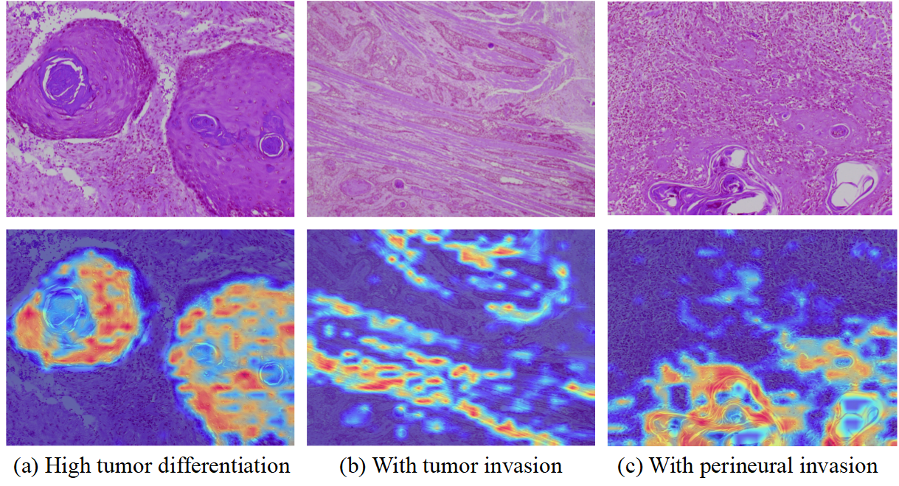
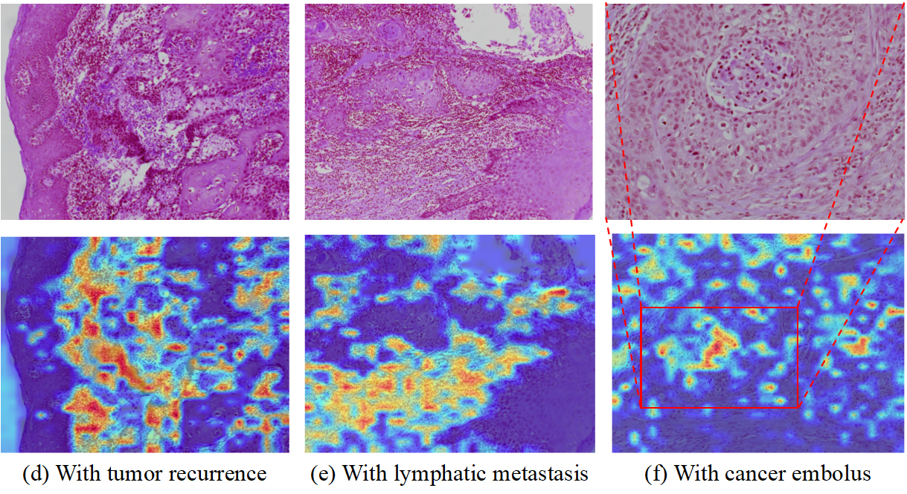

# OSCC-PathologyImageDataset

## (1) Multi-OSCC Datasets

### 1-1 Dataset Download

- Download the data from Zenodo: https://zenodo.org/records/16842637
- Download the data from Baidu NetDisk (with password `oscc`): https://pan.baidu.com/s/1m27QaBIC4HxdBUBrIMbbNg?pwd=oscc

### 1-2 Dataset Split

Following random seed 42, we split the dataset into training, validation, and test sets with a ratio of 70:15:15.

The split file is:

```text
./Data/split_seed=2024.json
```

### 1-3 Image Labels

The image labels are saved in:

```text
./Data/all_metadata.json
```

---

## (2) Baseline Weights

### 2-1 Best Setting of Each Task

The best setting of each task is shown in the following table. These models are trained in the single-task mode.

| Task | AUC(%) | Setting |
|---|---|---|
| REC | 94.72% | ViT-Base (Hibou-B) |
| LNM | 71.06% | ViT-Small (PathoBench with Reinhard stain normalization) |
| TD | 81.23% | ViT-Base (CONCH) |
| TI | 72.6% | ViT-Base (PathoBench with Macenko stain normalization) |
| CE | 75.52% | Swin-Base (Imagenet) |
| PI | 74.17% | ViT-Base (CONCH) |

### 2-2 Final Benchmark Results After Unified Model Settings

The benchmark results of the unified model settings are shown in the following table.

| Benchmark | REC | LNM | TD | TI | CE | PI |
|---|---|---|---|---|---|---|
| Single-Task AUC(%) | 93.13% | 71.06% | 75.21% | 72.47% | 75.52% | 66.19% |
| Multi-Task AUC(%) | 87.17% | 67.61% | 72.51% | 67.82% | 68.37% | 67.41% |

---

## (3) Environment

Follow the instructions below to create a conda environment with the required dependencies.

```bash
conda env create -f environment.yml
conda activate Multi-OSCCPI
pip install torch==1.13.0+cu116 torchvision==0.14.0+cu116 -f https://download.pytorch.org/whl/torch_stable.html
pip install -r requirements.txt
```

---

## (4) Single-Task Training

Single-task training scripts are organized by task under:

```text
Baseline/TrainScripts/ScriptsBenchmark/SingleTask-seed42/
```

Each task has its own folder, for example:

```text
ScriptsREC/
  train_runs_id=1_vit_bench.sh
  train_runs_id=5_vit_conch.sh
```

To run a single-task training script, use `bash` from the repository root. For example, for the REC task:

```bash
bash Baseline/TrainScripts/ScriptsBenchmark/SingleTask-seed42/ScriptsREC/train_runs_id=1_vit_bench.sh
```

or

```bash
bash Baseline/TrainScripts/ScriptsBenchmark/SingleTask-seed42/ScriptsREC/train_runs_id=5_vit_conch.sh
```

Please open the `.sh` file of the target task to check the exact arguments (data path, model name, batch size, learning rate, output directory, etc.) before running. The task folders are named as:

```text
ScriptsCE, ScriptsLNM, ScriptsPI, ScriptsREC, ScriptsTD, ScriptsTI
```

---

## (5) Visualization

<p align="center">
  
</p>

<p align="center">
  
</p>

---

## Cite This Work

If you use this dataset, please cite the following paper:

```bibtex
@misc{guan2025high,
    title={A High Magnifications Histopathology Image Dataset for Oral Squamous Cell Carcinoma Diagnosis and Prognosis},
    author={Jinquan Guan and Junhong Guo and Qi Chen and Jian Chen and Yongkang Cai and Yilin He and Zhiquan Huang and Yan Wang and Yutong Xie},
    year={2025},
    eprint={2507.16360},
    archivePrefix={arXiv},
    primaryClass={eess.IV}
}
```
